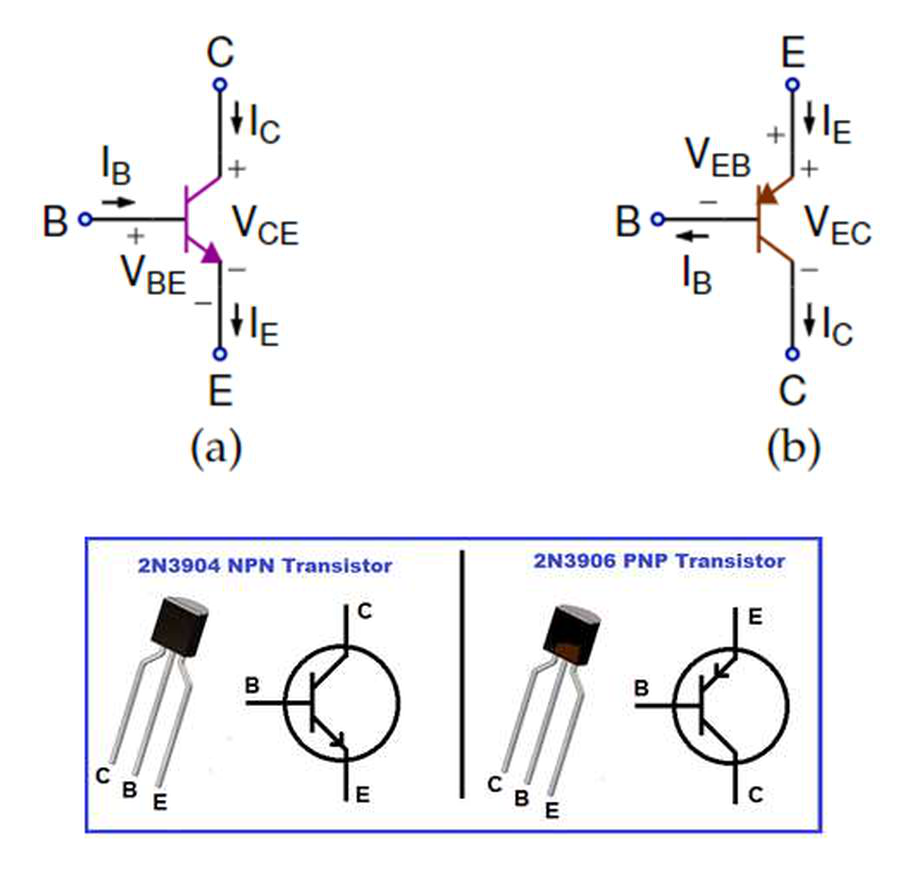
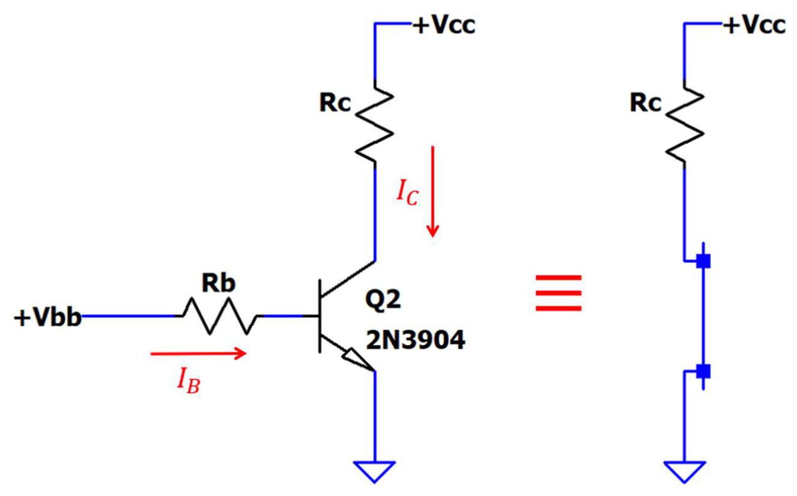
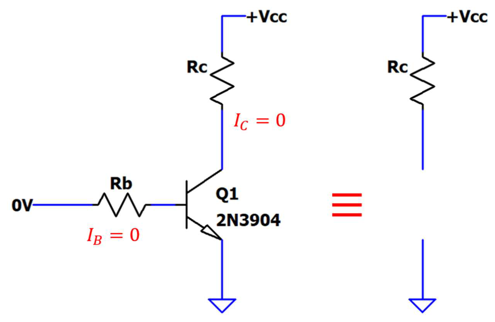
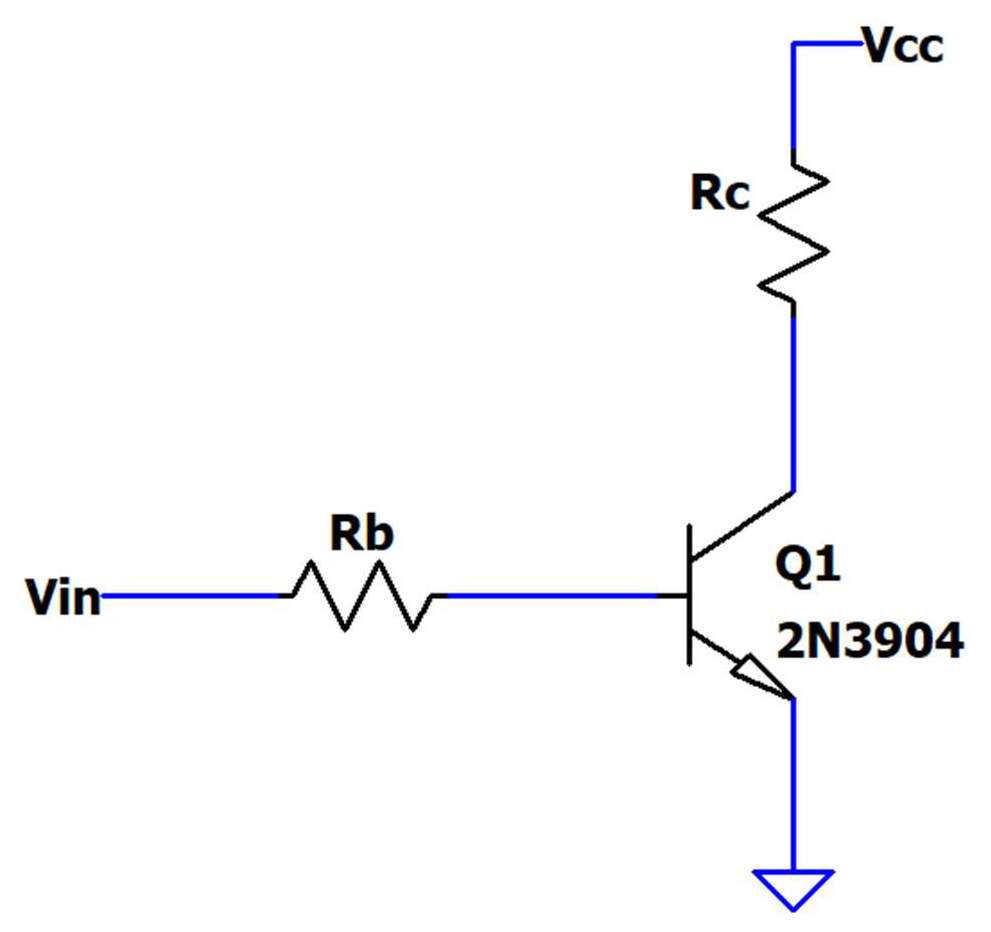
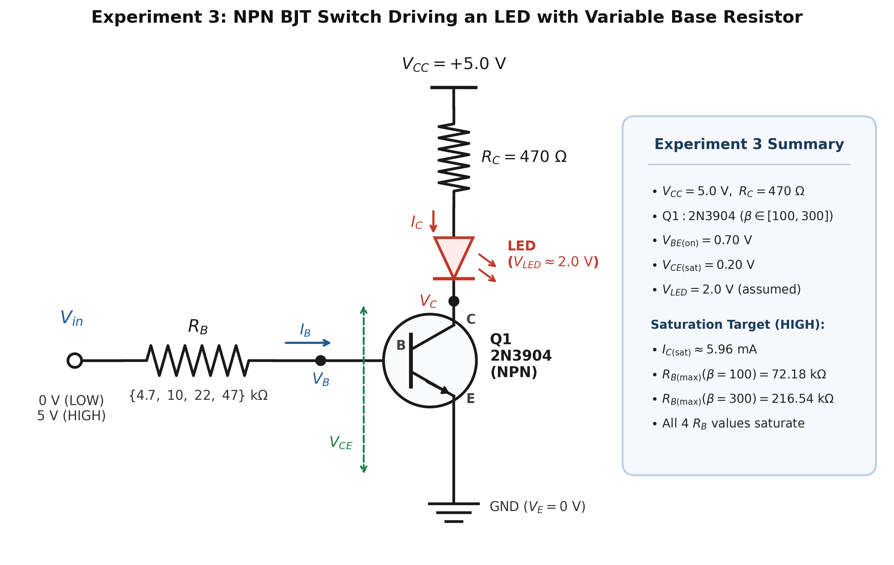
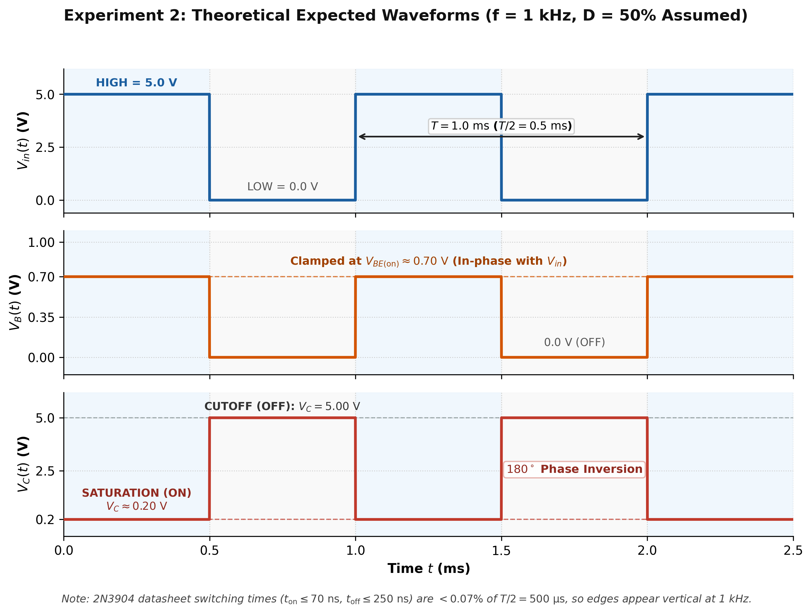
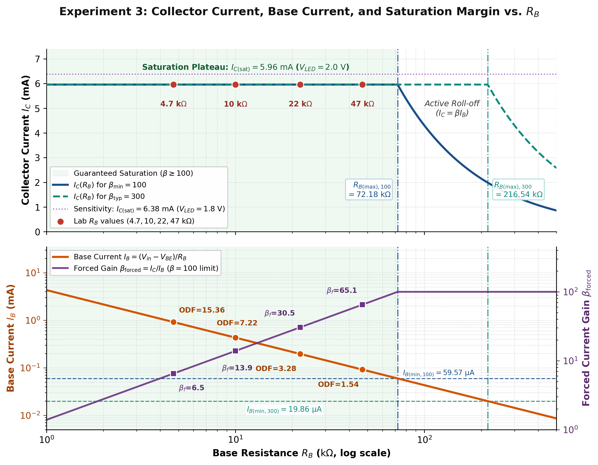

# EE091IU Electronics Devices Lab - Lab 5 Report

**International University - School of Electrical Engineering**  
**Course:** Electronics Devices Lab (`EE091IU`)  
**Title:** LAB 5: BJT Biasing in Switching Applications (NPN Transistor)  
**Submitted by:** Nguyễn Lê Minh Sang (`EEACIU24096`), Nguyễn Gia Huy (`EEACIU24047`)  
**Date Performed:** 21/11/2026 | **Date Submitted:** 21/11/2026  
**Lab Section:** Lab 5 | **Course Instructor:** Lecturer Pham Trung Kien  

---

## Table of Contents

- [List of Figures](#list-of-figures)
- [List of Tables](#list-of-tables)
- [Nomenclature](#nomenclature)
- [1. Objectives](#1-objectives)
- [2. Theoretical Background](#2-theoretical-background)
  - [2.1 NPN BJT Operating Regions and Switching Action](#21-npn-bjt-operating-regions-and-switching-action)
  - [2.2 Governing Equations (Sedra & Smith, 6th Edition)](#22-governing-equations-sedra--smith-6th-edition)
  - [2.3 Step-by-Step Theoretical Calculations](#23-step-by-step-theoretical-calculations)
- [3. Experimental Procedure](#3-experimental-procedure)
  - [3.1 Material and Equipment](#31-material-and-equipment)
  - [3.2 Experiment 1: Static Biasing and Switching](#32-experiment-1-static-biasing-and-switching)
  - [3.3 Experiment 2: Switching Response to Square Wave](#33-experiment-2-switching-response-to-square-wave)
  - [3.4 Experiment 3: Driving an LED](#34-experiment-3-driving-an-led)
- [4. Experimental Results](#4-experimental-results)
  - [4.1 Experiment 1: Static Biasing and Switching](#41-experiment-1-static-biasing-and-switching)
  - [4.2 Experiment 2: Switching Response to Square Wave](#42-experiment-2-switching-response-to-square-wave)
  - [4.3 Experiment 3: Driving an LED](#43-experiment-3-driving-an-led)
- [5. Discussion of Results](#5-discussion-of-results)
  - [5.1 Experiment 2 Switching Waveform Analysis (Lab Question 2c)](#51-experiment-2-switching-waveform-analysis-lab-question-2c)
  - [5.2 Experiment 3 Biasing, Minimum Base Current, and Base Resistor Tradeoffs (Lab Questions 3d)](#52-experiment-3-biasing-minimum-base-current-and-base-resistor-tradeoffs-lab-questions-3d)
  - [5.3 Non-Ideal Deviations and Lab Verification Checklist](#53-non-ideal-deviations-and-lab-verification-checklist)
  - [5.4 Summary](#54-summary)
- [References](#references)

---

## List of Figures

1. **Figure 1.** Bipolar junction transistor circuit symbols and TO-92 physical pinouts: (a) 2N3904 NPN and (b) 2N3906 PNP (`figures/fig1_bjt_symbol_pinout.png`).
2. **Figure 2.** NPN BJT switch in saturation: logic HIGH at the base pulls collector output $V_C$ LOW (`figures/fig2_switch_high.png`).
3. **Figure 3.** NPN BJT switch in cutoff: logic LOW at the base leaves collector output $V_C$ HIGH (`figures/fig3_switch_low.png`).
4. **Figure 4.** Experiment 1 circuit schematic for static biasing and switching of Q1 (2N3904) (`figures/fig4_exp1_circuit.png`).
5. **Figure 5.** Experiment 3 circuit schematic for driving a collector-side LED across four $R_B$ values (`figures/fig5_exp3_led_circuit.png`).
6. **Figure 6.** Experiment 2 theoretical waveforms $V_{in}(t)$, $V_B(t)$, and $V_C(t)$ for a 0-5 V, 1 kHz square wave ($D = 50\%$ assumed) (`figures/fig6_exp2_theoretical_waveforms.png`).
7. **Figure 7.** Experiment 3 analytical sweep of collector current $I_C$, base current $I_B$, overdrive factor (ODF), and forced gain $\beta_{\text{forced}}$ versus base resistance $R_B$ (`figures/fig7_exp3_rb_sweep.png`).

## List of Tables

1. **Table 1.** NPN BJT operating regions, junction bias states, and typical applications.
2. **Table 2.** Experiment 1 static biasing and switching results ($V_{CC} = 5\text{ V}$, $R_C = 470\ \Omega$, $R_B = 10\text{ k}\Omega$).
3. **Table 3.** Experiment 2 theoretical waveform levels and 2N3904 switching timing summary (1 kHz, $D = 50\%$ assumed).
4. **Table 4.** Experiment 3 LED driver results across four base resistors ($V_{CC} = 5\text{ V}$, $R_C = 470\ \Omega$, $V_{LED} = 2.0\text{ V}$ assumed, $V_{in} = 5\text{ V}$).

## Nomenclature

| Symbol | Definition |
|---|---|
| $V_{CC}$ | DC collector supply voltage ($5.0\text{ V}$ in all three experiments) |
| $V_{in}$ | Input control voltage applied ahead of $R_B$ ($0\text{ V}$ LOW or $5.0\text{ V}$ HIGH) |
| $V_B, V_C, V_E$ | Node voltages at base, collector, and emitter relative to ground ($V_E = 0\text{ V}$) |
| $V_{BE}, V_{BE(\text{on})}$ | Base-emitter voltage and forward-conduction drop ($0.70\text{ V}$) |
| $V_{CE}, V_{CE(\text{sat})}$ | Collector-emitter voltage and saturation drop ($0.20\text{ V}$ textbook model) |
| $V_{LED}$ | Forward voltage drop of collector-side LED ($2.0\text{ V}$ assumed nominal; $1.8\text{ V}$ sensitivity check) |
| $I_B, I_C$ | DC base current and collector current |
| $I_{C(\text{sat})}$ | Saturation collector current fixed by the external supply and load branch |
| $I_{B(\min)}, R_{B(\max)}$ | Minimum base current and maximum base resistance at the edge of saturation |
| $R_B, R_C$ | Base current-limiting resistor and collector load resistor ($R_C = 470\ \Omega$) |
| $\beta\ (h_{FE})$ | DC common-emitter current gain of the 2N3904 ($\beta_{\min} = 100$ at $10\text{ mA}$, $\beta_{\text{typ}} = 300$) |
| $\beta_{\text{forced}}$ | Forced current gain in saturation, $I_{C(\text{sat})} / I_B$ |
| $ODF$ | Overdrive factor, $I_B / I_{B(\min)} = \beta / \beta_{\text{forced}}$ |
| $P_Q, P_{RC}, P_{RB}$ | Steady-state power dissipated by Q1, $R_C$, and $R_B$ |
| $t_d, t_r, t_s, t_f$ | Delay, rise, storage, and fall times of the switching transistor |

---

## 1. Objectives

Lab 5 investigates how an NPN bipolar junction transistor (2N3904) behaves when biased strictly as an electronic switch. Instead of amplifying small analog signals, the transistor swings between full cutoff and full saturation under static DC levels, a 1 kHz square wave, and a collector-side LED load.

- Observe the ON/OFF switching behavior of a 2N3904 NPN BJT driven by digital logic voltage levels ($0\text{ V}$ and $5\text{ V}$).
- Calculate and verify the biasing conditions required to place the transistor reliably in cutoff and saturation.
- Design, analyze, and test a basic transistor switching stage driving both a purely resistive load ($470\ \Omega$) and a series LED load across four base resistor values.

---

## 2. Theoretical Background

### 2.1 NPN BJT Operating Regions and Switching Action

A bipolar junction transistor contains two p-n junctions: base-emitter (B-E) and base-collector (B-C). How those two junctions are biased determines which of three operating regions the device occupies. Figure 1 shows the circuit symbols and TO-92 physical pinouts for the 2N3904 NPN transistor alongside its PNP complement (2N3906).

**Table 1.** NPN BJT operating regions, junction bias states, and typical applications.

| Region | B-E Junction | B-C Junction | Terminal Condition | Primary Use |
|---|---|---|---|---|
| **Cutoff** | Reverse biased | Reverse biased | $V_{BE} < 0.70\text{ V}$, $I_B \approx 0$, $I_C \approx 0$, $V_{CE} \approx V_{CC}$ | Open switch (OFF) |
| **Active** | Forward biased | Reverse biased | $V_{BE} \approx 0.70\text{ V}$, $I_C = \beta I_B$, $V_{CE} > V_{CE(\text{sat})}$ | Linear amplification |
| **Saturation** | Forward biased | Forward biased | $V_{BE} \approx 0.70\text{ V}$, $V_{CE} \approx 0.20\text{ V}$, $I_C < \beta I_B$ | Closed switch (ON) |

Switching circuits deliberately skip the active region except during brief transitions. When logic HIGH ($5.0\text{ V}$) reaches the base through $R_B$, sufficient base current flows to forward-bias both junctions and drive Q1 into saturation. Collector-emitter voltage drops to $V_{CE(\text{sat})} \approx 0.20\text{ V}$, pulling output $V_C$ LOW (Figure 2).

When the base input falls to logic LOW ($0\text{ V}$), $V_{BE}$ drops below the turn-on threshold. Base and collector currents vanish, zero voltage drops across $R_C$, and Q1 acts as an open switch so $V_C$ stays HIGH at $V_{CC} = 5.0\text{ V}$ (Figure 3). Because HIGH in produces LOW out and LOW in produces HIGH out, this common-emitter stage operates as a digital inverter.

### 2.2 Governing Equations (Sedra & Smith, 6th Edition)

All hand calculations follow the piecewise-linear DC BJT model from Adel S. Sedra and Kenneth C. Smith, *Microelectronic Circuits* (6th ed., Chapter 6). For the grounded-emitter 2N3904 ($V_E = 0\text{ V}$), $V_B = V_{BE}$ and $V_C = V_{CE}$. Baseline parameters are $V_{CC} = 5.0\text{ V}$, $R_C = 470\ \Omega$, $V_{BE(\text{on})} = 0.70\text{ V}$, $V_{CE(\text{sat})} = 0.20\text{ V}$, datasheet minimum gain $\beta_{\min} = 100$ at $I_C = 10\text{ mA}$, and typical gain $\beta_{\text{typ}} = 300$.

$$I_B = \frac{V_{in} - V_{BE(\text{on})}}{R_B} \tag{1}$$

$$I_{C(\text{sat})} = \frac{V_{CC} - V_{CE(\text{sat})}}{R_C} \quad [\text{Experiment 1: resistive load}] \tag{2}$$

$$I_{C(\text{sat})} = \frac{V_{CC} - V_{LED} - V_{CE(\text{sat})}}{R_C} \quad [\text{Experiment 3: LED + resistor load}] \tag{3}$$

$$\beta_{\text{forced}} = \frac{I_{C(\text{sat})}}{I_B} < \beta \tag{4}$$

$$I_{B(\min)} = \frac{I_{C(\text{sat})}}{\beta}, \qquad R_{B(\max)} = \frac{V_{in} - V_{BE(\text{on})}}{I_{B(\min)}} \tag{5}$$

$$ODF = \frac{I_B}{I_{B(\min)}} = \frac{\beta}{\beta_{\text{forced}}} \tag{6}$$

$$P_Q = V_{CE} I_C + V_{BE} I_B, \qquad P_{RC} = I_C^2 R_C, \qquad P_{RB} = I_B^2 R_B \tag{7}$$

Worst-case active-region collector dissipation on the DC load line is $P_{C,\max} = V_{CC}^2 / (4 R_C)$ (Experiment 1) or $(V_{CC} - V_{LED})^2 / (4 R_C)$ (Experiment 3).

### 2.3 Step-by-Step Theoretical Calculations

#### Experiment 1: Static Biasing and Switching ($R_B = 10\text{ k}\Omega$)

- **State 1 ($V_{in} = 0\text{ V}$, Cutoff):** $V_{BE} = V_B = 0.00\text{ V} < 0.70\text{ V}$, $I_B = 0.000\text{ mA}$, $I_C = 0.00\text{ mA}$, $V_{CE} = V_C = 5.00\text{ V}$, $P_Q = P_{RC} = P_{RB} = 0.00\text{ mW}$.
- **State 2 ($V_{in} = 5.0\text{ V}$, Saturation):**
  - $I_B = (5.0 - 0.70) / 10\text{ k}\Omega = \mathbf{0.430\text{ mA}}$ ($430.0\ \mu\text{A}$).
  - $I_{C(\text{sat})} = (5.0 - 0.20) / 470\ \Omega = \mathbf{10.2128\text{ mA} \approx 10.21\text{ mA}}$.
  - $V_B = V_{BE} = \mathbf{0.70\text{ V}}$; $V_C = V_{CE} = \mathbf{0.20\text{ V}}$.
  - Saturation check: $\beta_{\text{forced}} = 10.2128 / 0.430 = \mathbf{23.75} < \beta_{\min} = 100$.
  - Boundaries: At $\beta_{\min} = 100$, $I_{B(\min)} = \mathbf{102.13\ \mu\text{A}}$, $R_{B(\max)} = \mathbf{42.10\text{ k}\Omega}$, $ODF_{100} = \mathbf{4.21}$. At $\beta_{\text{typ}} = 300$, $I_{B(\min)} = \mathbf{34.04\ \mu\text{A}}$, $R_{B(\max)} = \mathbf{126.31\text{ k}\Omega}$, $ODF_{300} = \mathbf{12.63}$.
  - Power check: $P_Q = 2.34\text{ mW} \ll 625\text{ mW}$, $P_{RC} = 49.02\text{ mW}$, $P_{RB} = 1.85\text{ mW}$. Active-region collector peak $P_{C,\max} = 13.30\text{ mW}$.

#### Experiment 2: Switching Response to a 1 kHz Square Wave

- Input: $0\text{-}5\text{ V}$ square wave at $f = 1\text{ kHz}$ with assumed duty cycle $D = 50\%$, giving $T = 1.00\text{ ms}$ and $T_{\text{HIGH}} = T_{\text{LOW}} = 0.50\text{ ms} = 500\ \mu\text{s}$.
- $V_B(t)$: clamped between $0.00\text{ V}$ and $0.70\text{ V}$, in phase ($0^\circ$) with $V_{in}(t)$.
- $V_C(t)$: inverted ($180^\circ$ phase shift) between $5.00\text{ V}$ (cutoff) and $0.20\text{ V}$ (saturation).
- Datasheet 2N3904 switching times: $t_d \le 35\text{ ns}$, $t_r \le 35\text{ ns}$ ($t_{\text{on}} \le 70\text{ ns}$), $t_s \le 200\text{ ns}$, $t_f \le 50\text{ ns}$ ($t_{\text{off}} \le 250\text{ ns}$). Ratio $(t_{\text{on}} + t_{\text{off}})/(T/2) \le 0.064\%$. Even with passive turn-off storage delay ($t_s \approx 0.5\text{-}2\ \mu\text{s}$), total delay stays below $0.5\%$ of $T/2$.

#### Experiment 3: Driving a Collector-Side LED across Four Base Resistors

- Assumed LED forward drop: $V_{LED} = 2.0\text{ V}$ (nominal).
- $I_{C(\text{sat})} = (5.0 - 2.0 - 0.20) / 470 = \mathbf{5.9574\text{ mA} \approx 5.96\text{ mA}}$.
- Collector-branch power: $P_{RC} = 16.68\text{ mW}$, $P_{LED} = 11.91\text{ mW}$, active-region peak $P_{C,\max} = 4.79\text{ mW}$.
- Saturation limits: $\beta_{\min} = 100 \Rightarrow I_{B(\min)} = 59.57\ \mu\text{A},\ R_{B(\max)} = 72.18\text{ k}\Omega$; $\beta_{\text{typ}} = 300 \Rightarrow I_{B(\min)} = 19.86\ \mu\text{A},\ R_{B(\max)} = 216.54\text{ k}\Omega$. Rule-of-thumb $\beta_{\text{forced}} = 10 \Rightarrow I_B \approx 0.60\text{ mA},\ R_B \approx 7.22\text{ k}\Omega$.
- Sensitivity ($V_{LED} = 1.8\text{ V}$): $I_{C(\text{sat})} = 6.38\text{ mA}$ ($+7.14\%$), $I_{B(\min,100)} = 63.83\ \mu\text{A}$, $R_{B(\max,100)} = 67.37\text{ k}\Omega$ (all four lab resistors still saturate).
- Per-resistor summary at $V_{in} = 5.0\text{ V}$ ($V_{BE} = 0.70\text{ V}$, $V_{CE} = 0.20\text{ V}$, $I_C = 5.96\text{ mA}$):
  - $R_B = 4.7\text{ k}\Omega$: $I_B = 0.915\text{ mA}$, $\beta_{\text{forced}} = 6.51$, $ODF_{100} = 15.36$, $ODF_{300} = 46.07$, $P_Q = 1.83\text{ mW}$, $P_{RB} = 3.93\text{ mW}$ (Deep Saturation).
  - $R_B = 10\text{ k}\Omega$: $I_B = 0.430\text{ mA}$, $\beta_{\text{forced}} = 13.85$, $ODF_{100} = 7.22$, $ODF_{300} = 21.65$, $P_Q = 1.49\text{ mW}$, $P_{RB} = 1.85\text{ mW}$ (Saturation).
  - $R_B = 22\text{ k}\Omega$: $I_B = 0.195\text{ mA}$, $\beta_{\text{forced}} = 30.48$, $ODF_{100} = 3.28$, $ODF_{300} = 9.84$, $P_Q = 1.33\text{ mW}$, $P_{RB} = 0.84\text{ mW}$ (Saturation).
  - $R_B = 47\text{ k}\Omega$: $I_B = 0.0915\text{ mA}$, $\beta_{\text{forced}} = 65.12$, $ODF_{100} = 1.54$, $ODF_{300} = 4.61$, $P_Q = 1.26\text{ mW}$, $P_{RB} = 0.39\text{ mW}$ (Soft Saturation).

---

## 3. Experimental Procedure

### 3.1 Material and Equipment

1. Dual-channel Digital Storage Oscilloscope (with 10x probes)
2. DC Power Supply ($V_{CC} = 5.0\text{ V}$, current limit ~100 mA)
3. Function / Signal Generator (0-5 V, 1 kHz square wave)
4. Solderless breadboard and jumper wires
5. Digital Multimeter (DMM)
6. NPN Transistor 2N3904 (TO-92 pinout: E-B-C from left to right with flat face forward)
7. Resistors ($470\ \Omega$, $4.7\text{ k}\Omega$, $10\text{ k}\Omega$, $22\text{ k}\Omega$, $47\text{ k}\Omega$) and a standard indicator LED

### 3.2 Experiment 1: Static Biasing and Switching

1. Assemble Figure 4 with $V_{CC} = 5.0\text{ V}$, $R_C = 470\ \Omega$, $R_B = 10\text{ k}\Omega$, and Q1 = 2N3904.
2. Connect $V_{in}$ to $0\text{ V}$, then measure $V_{BE}$, $V_{CE}$, $V_C$, $V_B$, $I_B$, and $I_C$.
3. Move $V_{in}$ to $+5.0\text{ V}$, repeat all six measurements, and record simulation and bench values in Table 2.

### 3.3 Experiment 2: Switching Response to Square Wave

1. Keep the Experiment 1 circuit intact.
2. Set the signal generator to a $0\text{-}5\text{ V}$, $1\text{ kHz}$ square wave ($D = 50\%$), verifying the High-Z vs. $50\ \Omega$ load setting on the oscilloscope first.
3. Connect the generator to $V_{in}$ and tie grounds together.
4. Probe $V_B$ (CH1) and $V_C$ (CH2) using DC coupling, align 0 V baselines, and capture oscilloscope screenshots.

### 3.4 Experiment 3: Driving an LED

1. Insert the LED (anode toward $R_C$, cathode toward Q1 collector) in series with $R_C = 470\ \Omega$ as in Figure 5.
2. With $R_B = 10\text{ k}\Omega$, toggle $V_{in}$ between $0\text{ V}$ and $5\text{ V}$ and verify LED OFF/ON switching.
3. Hold $V_{in} = 5\text{ V}$ and measure $V_{BE}$, $V_{CE}$, $I_B$, and $I_C$ for $R_B = 4.7\text{ k}\Omega$, $10\text{ k}\Omega$, $22\text{ k}\Omega$, and $47\text{ k}\Omega$. Record results in Table 4.

---

## 4. Experimental Results

All **Calculation** rows below contain verified theoretical predictions. All **Simulation** and **Measurement** rows, the Experiment 2 oscilloscope capture area, and the Experiment 3 bench observation log are left blank for completion during lab execution.

### 4.1 Experiment 1: Static Biasing and Switching

**Table 2.** Experiment 1 static biasing and switching results ($V_{CC} = 5\text{ V}$, $R_C = 470\ \Omega$, $R_B = 10\text{ k}\Omega$).

| $V_{in}$ | Mode | $V_{BE}$ (V) | $V_{CE}$ (V) | $V_C$ (V) | $V_B$ (V) | $I_B$ (mA) | $I_C$ (mA) |
|---|---|---|---|---|---|---|---|
| 0 V | **Calculation** | 0.00 | 5.00 | 5.00 | 0.00 | 0.000 | 0.00 |
| 0 V | Simulation | | | | | | |
| 0 V | Measurement | | | | | | |
| 5 V | **Calculation** | 0.70 | 0.20 | 0.20 | 0.70 | 0.430 | 10.21 |
| 5 V | Simulation | | | | | | |
| 5 V | Measurement | | | | | | |

### 4.2 Experiment 2: Switching Response to Square Wave

**Table 3.** Experiment 2 theoretical waveform levels and 2N3904 switching timing summary (1 kHz, $D = 50\%$ assumed).

| Parameter | Theoretical Prediction | Measured / Observed (Lab) |
|---|---|---|
| Input $V_{in}(t)$ levels & period | 0.00 V to 5.00 V; $T = 1.00\text{ ms}$ ($T/2 = 0.50\text{ ms}$) | |
| Base voltage $V_B(t)$ levels | 0.00 V (OFF) to 0.70 V (clamped ON) | |
| Base phase relative to $V_{in}(t)$ | $0^\circ$ (in phase) | |
| Collector voltage $V_C(t)$ levels | 5.00 V (cutoff) to 0.20 V (saturation) | |
| Collector phase relative to $V_{in}(t)$ | $180^\circ$ (logic inversion) | |
| 2N3904 switching times (datasheet) | $t_{\text{on}} \le 70\text{ ns}$, $t_{\text{off}} \le 250\text{ ns}$ ($\le 0.064\%$ of $T/2$) | |

> **[Oscilloscope Capture Area - Experiment 2]**  
> *Paste measured CH1 ($V_B$) and CH2 ($V_C$) oscilloscope screenshots here during the lab session.*

### 4.3 Experiment 3: Driving an LED

**Table 4.** Experiment 3 LED driver results across four base resistors ($V_{CC} = 5\text{ V}$, $R_C = 470\ \Omega$, $V_{LED} = 2.0\text{ V}$ assumed, $V_{in} = 5\text{ V}$).

| $R_B$ | Mode | $V_{BE}$ (V) | $V_{CE}$ (V) | $I_B$ (mA) | $I_C$ (mA) |
|---|---|---|---|---|---|
| 4.7 kΩ | **Calculation** | 0.70 | 0.20 | 0.915 | 5.96 |
| 4.7 kΩ | Simulation | | | | |
| 4.7 kΩ | Measurement | | | | |
| 10 kΩ | **Calculation** | 0.70 | 0.20 | 0.430 | 5.96 |
| 10 kΩ | Simulation | | | | |
| 10 kΩ | Measurement | | | | |
| 22 kΩ | **Calculation** | 0.70 | 0.20 | 0.195 | 5.96 |
| 22 kΩ | Simulation | | | | |
| 22 kΩ | Measurement | | | | |
| 47 kΩ | **Calculation** | 0.70 | 0.20 | 0.0915 | 5.96 |
| 47 kΩ | Simulation | | | | |
| 47 kΩ | Measurement | | | | |

**Bench Observation Log (Experiment 3 - Fill In During Lab):**

| Observation Item | Recorded Bench Value / Notes |
|---|---|
| LED color and measured forward drop $V_{LED}$ (V) | |
| LED ON/OFF behavior at $V_{in} = 0\text{ V}$ vs. $5\text{ V}$ ($R_B = 10\text{ k}\Omega$) | |
| Measured DC current gain $h_{FE}$ ($\beta$) of bench 2N3904 | |
| Visual LED brightness trend from $R_B = 4.7\text{ k}\Omega$ to $47\text{ k}\Omega$ | |

---

## 5. Discussion of Results

### 5.1 Experiment 2 Switching Waveform Analysis (Lab Question 2c)

Driving the 2N3904 base with a 0-5 V, 1 kHz square wave exposes two clear features on the oscilloscope. First, collector voltage $V_C(t)$ is a $180^\circ$ inverted copy of $V_{in}(t)$. When the input jumps to $5.0\text{ V}$, base current rises to $0.430\text{ mA}$, Q1 saturates, and $V_C$ drops to roughly $0.20\text{ V}$. When the input returns to $0\text{ V}$, Q1 cuts off and $R_C$ pulls $V_C$ back up to $5.00\text{ V}$. The stage functions directly as a single-transistor digital NOT gate.

Second, base voltage $V_B(t)$ never climbs to $5.0\text{ V}$. Instead, it tracks $V_{in}(t)$ in phase ($0^\circ$ shift) while remaining clamped between $0.00\text{ V}$ and roughly $0.70\text{ V}$. Why? Because the forward-biased base-emitter junction behaves like a silicon diode connected straight to ground. Its exponential I-V curve locks $V_B$ near $0.70\text{ V}$, forcing the $10\text{ k}\Omega$ base resistor to absorb the remaining $4.30\text{ V}$.

At 1 kHz, the half-period is $500\ \mu\text{s}$. Against that window, the 2N3904's datasheet turn-on time ($t_{\text{on}} \le 70\text{ ns}$) and turn-off time ($t_{\text{off}} \le 250\text{ ns}$) occupy at most $0.064\%$ of one pulse. Transitions therefore appear sharp and vertical on a standard timebase. On an actual breadboard without a negative turn-off bias, excess minority carriers stored in the base during saturation must discharge passively through $R_B = 10\text{ k}\Omega$. That passive discharge stretches storage time $t_s$ to roughly $0.5\text{-}2\ \mu\text{s}$, which is still tiny at 1 kHz ($< 0.5\%$ of $T/2$) but would visibly distort the collector turn-off edge if frequency were pushed into the hundreds of kilohertz.

### 5.2 Experiment 3 Biasing, Minimum Base Current, and Base Resistor Tradeoffs (Lab Questions 3d)

**When is the transistor in cutoff or saturation?**  
An NPN transistor enters **cutoff** when both the B-E and B-C junctions are reverse-biased (or zero-biased). Practically, that occurs whenever $V_{BE}$ falls below the turn-on threshold (~0.5-0.7 V), cutting off base current ($I_B \approx 0$) and collector current ($I_C \approx 0$). In Experiment 1, the collector node voltage rises to $V_{CC}$ ($5.00\text{ V}$); in Experiment 3, the LED enters its non-conducting off state with zero collector current.

The transistor enters **saturation** when both the B-E and B-C junctions are forward-biased. Two linked conditions confirm saturation: the base current exceeds $I_{B(\min)} = I_{C(\text{sat})} / \beta$ (equivalently, $\beta_{\text{forced}} = I_{C(\text{sat})} / I_B < \beta$), and $V_{CE}$ collapses to $V_{CE(\text{sat})} \approx 0.20\text{ V}$ (often $0.07\text{-}0.15\text{ V}$ on a real 2N3904 at 6-10 mA). Once saturated, $I_C$ stops tracking $\beta I_B$ and is instead fixed by the supply voltage and collector load.

**What is the minimum base current required to drive the transistor into saturation?**  
In **Experiment 1** ($I_{C(\text{sat})} = 10.21\text{ mA}$), reaching the edge of saturation requires $I_{B(\min)} = \mathbf{102.13\ \mu\text{A}}$ at worst-case $\beta_{\min} = 100$ ($R_{B(\max)} = 42.10\text{ k}\Omega$), or $\mathbf{34.04\ \mu\text{A}}$ at typical $\beta_{\text{typ}} = 300$ ($R_{B(\max)} = 126.31\text{ k}\Omega$).

In **Experiment 3** ($I_{C(\text{sat})} = 5.96\text{ mA}$ at $V_{LED} = 2.0\text{ V}$), the minimum base current drops to $\mathbf{59.57\ \mu\text{A}}$ at $\beta_{\min} = 100$ ($R_{B(\max)} = 72.18\text{ k}\Omega$) and $\mathbf{19.86\ \mu\text{A}}$ at $\beta_{\text{typ}} = 300$ ($R_{B(\max)} = 216.54\text{ k}\Omega$). If a red LED with $V_{LED} = 1.8\text{ V}$ is used, $I_{C(\text{sat})}$ rises to $6.38\text{ mA}$ and $I_{B(\min,100)}$ shifts to $\mathbf{63.83\ \mu\text{A}}$ ($R_{B(\max,100)} = 67.37\text{ k}\Omega$). Using the standard forced-gain rule $\beta_{\text{forced}} = 10$ gives a practical target of $I_B \approx \mathbf{0.60\text{ mA}}$ ($R_B \approx 7.22\text{ k}\Omega$).

**What happens if $R_B$ is too large or too small?**  
- **If $R_B$ is too large ($R_B > R_{B(\max)}$):** Base current drops below $I_{B(\min)}$ and the transistor slips out of saturation into the active region. Collector current falls as $I_C = \beta I_B$, $V_{CE}$ climbs above $0.20\text{ V}$, the LED dims, and transistor dissipation $P_Q = V_{CE} I_C$ rises toward the load-line peak ($4.79\text{ mW}$ in Experiment 3, $13.30\text{ mW}$ in Experiment 1). Across our four lab resistors ($4.7\text{ k}\Omega$ to $47\text{ k}\Omega$), Q1 stays saturated, though $47\text{ k}\Omega$ sits in soft saturation ($ODF_{100} = 1.54$, $\beta_{\text{forced}} = 65.12$).
- **If $R_B$ is too small ($R_B \ll R_{B(\max)}$):** Base current rises sharply without making the LED any brighter because $I_C$ is already capped at $I_{C(\text{sat})}$. Instead, the input source is loaded down, excess power is wasted as heat across $R_B$ and the B-E junction (risking damage if $I_B$ exceeds device limits), and excess minority charge stored in the base lengthens storage time $t_s$, slowing turn-off at higher switching frequencies.

### 5.3 Non-Ideal Deviations and Lab Verification Checklist

Piecewise-linear hand math keeps equations clean, yet real silicon transistors and SPICE models follow continuous exponential physics (Ebers-Moll). Three systematic differences should be expected when comparing simulation and measurement against the Calculation rows:

- **Weak $V_{BE}$ shift in saturation:** Rather than staying frozen at $0.70\text{ V}$, actual $V_{BE}$ drops by only about $10\text{-}15\text{ mV}$ (from roughly $0.73\text{ V}$ down to $0.71\text{ V}$) across the full decade from $R_B = 4.7\text{ k}\Omega$ to $47\text{ k}\Omega$. The textbook $\approx 60\text{ mV/decade}$ rule applies to forward junction current $I_F \approx I_E$, not to $R_B$ or $I_B$ while $I_C$ is pinned by the collector load; because $I_E = I_C + I_B$ stays dominated by the nearly constant $I_C \approx 6.1\text{ mA}$, $V_{BE}$ barely moves. Instead, the logarithmic variation with $I_B$ shifts primarily into the forward-biased base-collector junction ($V_{BC}$ decreases as saturation overdrive drops), pushing $V_{CE(\text{sat})} = V_{BE} - V_{BC}$ upward.
- **Lower real $V_{CE(\text{sat})}$ and gentle rise with $R_B$:** Real 2N3904 saturation voltage at 6-10 mA typically measures $0.07\text{-}0.15\text{ V}$ rather than the conservative $0.20\text{ V}$ textbook bound. Ebers-Moll modeling at $\beta = 100$ predicts $V_{CE(\text{sat})}$ rising from $0.073\text{ V}$ at $4.7\text{ k}\Omega$ to $0.153\text{ V}$ at $47\text{ k}\Omega$ as overdrive tapers off.
- **Slightly higher measured $I_C$:** Because actual $V_{CE(\text{sat})}$ is smaller than $0.20\text{ V}$, real collector current tends to sit $2\text{-}4.5\%$ above hand calculation (around $10.40\text{ mA}$ in Experiment 1 and $6.06\text{-}6.23\text{ mA}$ in Experiment 3), plus any offset from actual LED forward voltage and $\pm 5\%$ resistor tolerances.

**Practical Lab Verification Checklist:**

- Confirm 2N3904 TO-92 orientation (flat face forward: E-B-C left to right).
- Check signal generator load mode (High-Z vs. $50\ \Omega$) before applying the 1 kHz square wave in Experiment 2.
- Measure actual resistor values and verify LED polarity before logging Experiment 3.
- Record the bench LED color and measured $V_{LED}$ in Section 4.3 before computing percentage error.

### 5.4 Summary

The analytical design confirms that a 2N3904 NPN common-emitter stage switches cleanly between cutoff ($V_C = 5.00\text{ V}$, $I_C = 0\text{ mA}$) and saturation ($V_C \approx 0.20\text{ V}$, $I_C = 10.21\text{ mA}$ resistive or $5.96\text{ mA}$ with a $2.0\text{ V}$ LED) under a $0\text{-}5\text{ V}$ control signal. All four Experiment 3 base resistors ($4.7\text{ k}\Omega$, $10\text{ k}\Omega$, $22\text{ k}\Omega$, and $47\text{ k}\Omega$) sit below the worst-case saturation limit of $72.18\text{ k}\Omega$, holding collector current steady while varying overdrive margin from deep saturation ($ODF_{100} = 15.36$) down to soft saturation ($ODF_{100} = 1.54$). Once LTspice simulations and bench measurements are entered into Tables 2 through 4 and the Experiment 2 oscilloscope frame, direct percentage-error checks against these predictions will complete the experimental verification.

---

## References

1. A. S. Sedra and K. C. Smith, *Microelectronic Circuits*, 6th ed. New York, NY: Oxford University Press, 2010.
2. ON Semiconductor, *2N3904 / MMBT3904 / PZT3904 NPN General-Purpose Amplifier Datasheet*, Rev. 8, 2014.
3. School of Electrical Engineering, International University (HCMIU), *EE091IU Electronics Devices Lab: Lab 5 Manual - BJT Biasing in Switching Applications (NPN Transistor)*, 2026.
